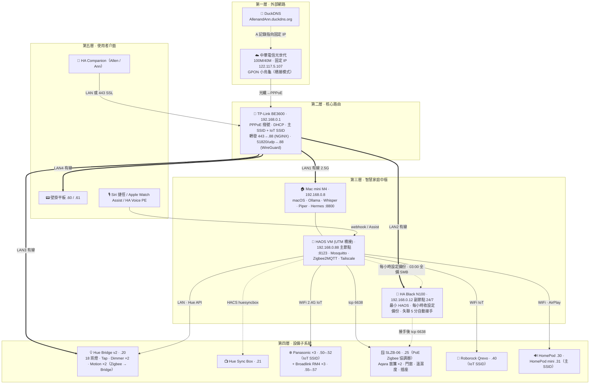

# 01 · 網路拓樸實作

> 目標：把 `design/topology.html` 的五層拓樸真的接起來，並且每台設備都有固定 IP、能從外面安全連回家。
> 完成判準：§1.8 的 10 項檢查全部通過。

## 1.1 五層拓樸圖

渲染版：`assets/topology.png`（3600×2480，canvas 繪製）；原始碼 `assets/topology-canvas.html`，改 `node(...)`／`edge(...)` 宣告後依 `assets/topology-design.md` 的指令重新輸出。舊版 Mermaid 稿 `assets/topology.mmd` 保留供對照。



## 1.2 IP 位址規劃（DHCP 保留）

網段 `192.168.0.0/24`，路由器 `192.168.0.1`，DHCP 動態池 `192.168.0.101–199`（`.100` 保留給 VIP），以下全部用 **DHCP 保留**（依 MAC 固定發同一個 IP），不要在設備端手動設靜態 IP。

| IP | 設備 | 連線 | 備註 |
|---|---|---|---|
| .1 | TP-Link BE3600 | — | 閘道 / DNS |
| **.8** | Mac mini M4（macOS 主機，主機名稱 `allenchaldeMini`，mDNS `allenchaldeMini.local`） | LAN1 有線 | Hermes :8800、Ollama :11434、Whisper :10300、Piper :10200 |
| **.88** | Home Assistant（HAOS 虛擬機，橋接走 Mac mini 網卡、獨立 MAC；青鳥路線即 Docker 主節點） | 橋接 | :8123、MQTT :1883；`homeassistant.local` |
| .12 | HA Black（副節點，24/7 熱備；LB-B） | LAN2 有線 | :8123、SMB :445、Tailscale、HAProxy/keepalived |
| .13 | LB-A（Mac mini 上的 Alpine VM，橋接） | 橋接 | HAProxy + keepalived（11 章） |
| .100 | VIP（keepalived 虛擬 IP） | — | 手機 / 捷徑 / Hermes / Wyoming 的統一入口（11 章） |
| .20 | Hue Bridge v2 | LAN3 有線 | Hue API :443 |
| .21 | Hue Play HDMI Sync Box | WiFi 主 SSID | |
| .25 | SLZB-06 Zigbee 協調器 | LAN（PoE） | tcp 6638；同時只接受一個 Z2M 連線（主→副接手） |
| .30 / .31 | HomePod / HomePod mini | WiFi 主 SSID | AirPlay；**必須與 HAOS 同網段** |
| .40 | Roborock Qrevo Edge C | WiFi IoT SSID（2.4G） | |
| .50 / .51 / .52 | Panasonic 客廳 / 主臥 / 次臥 WiFi 模組 | WiFi IoT SSID（2.4G） | |
| .55 / .56 / .57 | Broadlink RM4 mini 客廳 / 主臥 / 次臥 | WiFi IoT SSID（2.4G） | 選配本地 IR |
| .60 / .61 | 壁掛平板 玄關 / 客廳 | LAN4 或 WiFi | |
| .70 | HA Voice PE（選配） | WiFi 主 SSID | |
| .101–.199 | 手機、筆電 | DHCP | |

## 1.3 SSID 規劃

| SSID | 頻段 | 誰用 | 設定 |
|---|---|---|---|
| `AllenAnn` | 2.4 + 5 + 6 GHz（Smart Connect） | 手機、HomePod、Sync Box、平板、Mac mini WiFi（備用） | WPA3/WPA2 混合 |
| `AllenAnn-IoT` | 僅 2.4 GHz | Panasonic、Roborock、Broadlink | WPA2；關閉「用戶端隔離」(AP isolation) 讓 HAOS 能找到它們 |

⚠️ BE3600 這類消費級路由器沒有真正的 802.1Q VLAN。憲章要求的「IoT 隔離」用 TP-Link 的 **IoT Network** 功能達成：它是獨立 SSID，但預設允許與主網互通（這正是我們要的，HAOS 要能連空調）。真正隔離等以後換 Omada / UniFi 再做。

## 1.4 中華電信 + 固定 IP + DuckDNS

1. **小烏龜改橋接模式**：打 123 客服要求「橋接（bridge）模式、固定 IP 由自有路由器 PPPoE 撥號」。固定 IP 方案通常是 PPPoE 帳號加 `@ip.hinet.net` 後綴（例：`87654321@ip.hinet.net`），客服會給。
2. **BE3600 WAN**：網際網路 → 連線類型 PPPoE → 填帳號（含 `@ip.hinet.net`）/ 密碼 → 連線。WAN 狀態顯示 `122.117.5.107` 即成功。
3. **DuckDNS**：https://www.duckdns.org 用 GitHub/Google 登入 → 新增子網域 `AllenandAnn` → 記下 token。IP 欄位填 `122.117.5.107`。
   - 雖是固定 IP，之後仍會在 HAOS 裝 DuckDNS 附加元件（07 章）：它順便幫你簽 Let's Encrypt 憑證並每 5 分鐘續報 IP。
4. 驗證：在手機 4G 下 `nslookup AllenandAnn.duckdns.org` 應回 `122.117.5.107`。

## 1.5 TP-Link BE3600 逐步設定

用瀏覽器開 `http://192.168.0.1`（或 TP-Link Tether App）。

### A. 基本

| 位置 | 設定 |
|---|---|
| 進階 → 網路 → LAN | IP `192.168.0.1`，子網路 `255.255.255.0` |
| 進階 → 網路 → DHCP 伺服器 | 位址池 `192.168.0.101 – 192.168.0.199`（.100 留給 VIP）；主要 DNS `192.168.0.1`，備用 `1.1.1.1` |
| 進階 → 網路 → DHCP → 位址保留 | 依 §1.2 一台一台加（先讓設備連上拿到動態 IP，再從「DHCP 用戶端清單」按「保留」最省事） |
| 進階 → 系統 → 時間 | 時區 `(UTC+08:00) 台北`，NTP `time.stdtime.gov.tw` |
| 進階 → 系統 → LED | 夜間模式 23:00–07:00（純舒適） |

### B. 無線

| 位置 | 設定 |
|---|---|
| 無線 → 主網路 | SSID `AllenAnn`，Smart Connect 開，WPA2/WPA3 |
| 無線 → IoT 網路 | 開啟，SSID `AllenAnn-IoT`，只勾 2.4 GHz，WPA2-PSK，**允許存取區域網路** 開 |
| 無線 → 進階 | 2.4 GHz 頻道固定 1 / 6 / 11 其中之一（避開 Zigbee：Zigbee 用 ch 15 或 20 時，WiFi 2.4G 選 ch 11 或 1） |
| 無線 → 進階 → Airtime Fairness / 快速漫遊 | IoT 網路關閉 802.11r（部分 IoT 模組不支援） |

### C. 連接埠轉發（進階 → NAT 轉發 → 虛擬伺服器）

| 名稱 | 外部埠 | 內部 IP | 內部埠 | 協定 | 用途 |
|---|---|---|---|---|---|
| ha-https | 443 | 192.168.0.88 | 443 | TCP | HAOS NGINX SSL Proxy 附加元件（07 章） |
| wireguard | 51820 | 192.168.0.88 | 51820 | UDP | WireGuard 附加元件（07 章） |

**不要轉發 8123、1883、22、11434、8800**。外部只開 443 和 51820。

### D. 其他

| 位置 | 設定 |
|---|---|
| 進階 → 安全性 → 防火牆 | SPI 開 |
| 進階 → 安全性 → 存取控制 | 暫不設定（之後可做白名單） |
| 進階 → NAT 轉發 → UPnP | **關閉** |
| 進階 → 網路 → 進階 | IGMP Snooping 開（AirPlay / mDNS 跨頻段穩定） |

## 1.6 連接埠與服務總表

| 埠 | 協定 | 服務 | 主機 | 外部可達？ |
|---|---|---|---|---|
| 8123 | TCP | Home Assistant Web / API | .88 | 否（經 443 反代） |
| 443 | TCP | NGINX SSL proxy → 8123 | .88 | **是** |
| 51820 | UDP | WireGuard VPN | .88 | **是** |
| 1883 | TCP | Mosquitto MQTT | .88 | 否 |
| 445 | TCP | Samba（config / media / backup 分享） | .88 與 .12 | 否 |
| 6638 | TCP | SLZB-06 Zigbee 串列埠 | .25 | 否 |
| 41641 | UDP | Tailscale（出站打洞，不需轉發） | .88 / .12 | 否 |
| 11434 | TCP | Ollama API | .8 | 否 |
| 10300 | TCP | Wyoming MLX-Whisper（HA Black：faster-whisper） | .8 | 否 |
| 10200 | TCP | Wyoming Piper | .8 | 否 |
| 8800 | TCP | Hermes Agent（Ollama 相容 `/api/chat` + `/v1/*`） | .8 / VIP | 否 |
| 8900 | TCP | LINE / Telegram bot（青鳥） | .88 / VIP | 僅 /line/webhook 經 443 |
| 9000 | TCP | 青鳥後台 | .88 / .12 / VIP | 否 |
| 8404 | TCP | HAProxy 統計頁 | .13 / .12 | 否 |
| 22 | TCP | SSH（Mac mini / HA Black） | .8 / .12 | 否 |
| 5900 | TCP | macOS 螢幕共享 | .8 | 否 |
| 5353 | UDP | mDNS（HomeKit / AirPlay / `homeassistant.local`） | 全部 | 否 |
| 7000 / 49152+ | TCP | AirPlay 2（HomePod） | .30/.31 | 否 |

## 1.7 實體接線

| 路由器埠 | 接到 | 線材 |
|---|---|---|
| WAN 2.5G | 小烏龜 LAN1 | Cat6 |
| LAN1（若為 2.5G） | Mac mini 乙太網路 | Cat6 |
| LAN2 | HA Black | Cat5e+ |
| LAN5 或 PoE 交換器 | SLZB-06（放在屋子中央，離路由器 ≥ 1 m） | Cat5e+ |
| LAN3 | Hue Bridge v2 | Cat5e+（Hue Bridge 只有有線） |
| LAN4 | 壁掛平板 POE 注入器 → 平板 | Cat5e+ |

SLZB-06 放屋子中央、離路由器與 Mac mini ≥ 1 m（2.4 GHz 與 USB 3 干擾會讓 Zigbee 掉線）。若改用 USB Stick 備案，一定用 1 m USB 2.0 延長線。

## 1.8 驗證清單

在 Mac mini 終端機逐條執行：

```bash
# 1. 路由器可達
ping -c 3 192.168.0.1
# 2. 外網可達
ping -c 3 1.1.1.1
# 3. DNS
nslookup AllenandAnn.duckdns.org          # → 122.117.5.107
# 4. 本機 IP 正確（保留生效）
scutil --get ComputerName                 # → allenchaldeMini（系統設定 → 一般 → 關於 → 名稱）
ipconfig getifaddr en0                    # → 192.168.0.8（en0 為有線時）
# 5. Hue Bridge 回應
curl -sk https://192.168.0.20/api/config | head -c 200
# 6. HomePod 在同網段（AirPlay mDNS）
dns-sd -B _airplay._tcp local.            # 看得到 HomePod 與 HomePod mini（Ctrl+C 結束）
# 7. 手機切 4G 開 https://AllenandAnn.duckdns.org → 目前會失敗（07 章做完後成功），但 DNS 要先對
# 8. 外部埠掃描：手機 4G 用「Fing」掃 122.117.5.107，只應看到 443（07 章後）
# 9. 時間同步
sntp -sS time.stdtime.gov.tw
# 10. 把 §1.2 列印貼在路由器旁邊
```

全部通過 → 進 02 章。
